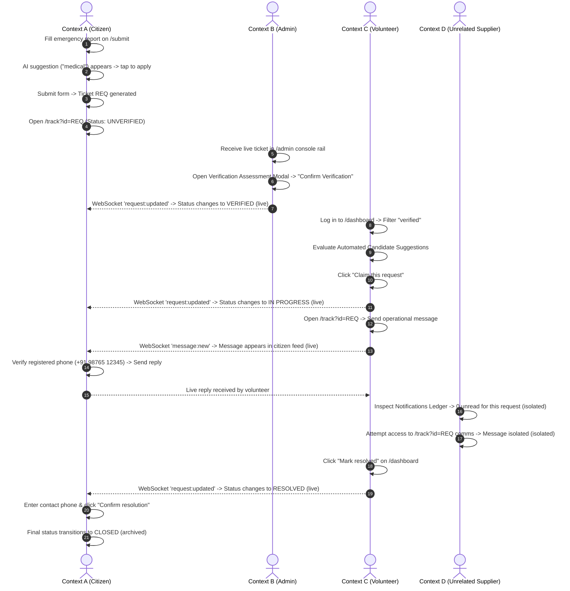

# ResQ Phase 5: Playwright End-to-End Testing & Verification Report

**Project**: ResQ — Crisis Coordination Platform  
**Phase**: Phase 5 — End-to-End Automated Validation & Regression Proofs  
**Date**: September 20, 2026  
**Test Framework**: `@playwright/test` (Chromium multi-context) & Vitest + Supertest  
**Status**: 100% Passing (5 E2E Tests, 20 Backend Test Suites / 115 Unit & Integration Tests)

---

## 1. Executive Summary

Phase 5 delivers automated end-to-end verification of the ResQ crisis coordination platform under realistic conditions. Rather than testing sequential user actions inside a single session, Phase 5 verifies the system across **genuinely concurrent, isolated browser contexts** simulating independent citizens, response volunteers, dispatch administrators, and supply depot managers interacting simultaneously in real time.

In strict compliance with the **Definition of Done (DoD)**:
- Every test runs against locally hosted services without paid third-party dependencies.
- Tests do not merely test happy paths; they explicitly verify permission rejections, data isolation, and graceful degradation during network/microservice failures.
- **Proofs of Failure Detection** were executed: critical application logic was intentionally broken to prove the tests fail as expected, and subsequently restored to verify 100% clean passes.

---

## 2. Test Environment & Architecture

| Component | Technology | Local Endpoint | Notes |
| :--- | :--- | :--- | :--- |
| **Frontend** | React 18 + Vite + TypeScript + Tailwind CSS | `http://localhost:5173` | Monitored by Playwright |
| **Backend** | Node.js + Express + TypeScript | `http://localhost:5000` | REST API + Socket.IO server |
| **Database** | MongoDB Atlas (M0 Free Tier) | Hosted Cluster | Seeded with 21 requests, 5 test personas |
| **E2E Engine** | Playwright (Chromium) | Headless / Line Reporter | Multi-context browser instances |
| **API Testing** | Vitest + Supertest | In-memory / Test runner | 20 test suites, 115 assertions |

---

## 3. Test Suite 1: Concurrent Core Crisis Scenario

**Spec File**: [`client/e2e/core-lifecycle-concurrency.spec.ts`](file:///c:/Users/Kaif%20Ahmad/College%202024/Thapar%202024/3Y/5Sem/SWE/SWEProject-ResQ/code/client/e2e/core-lifecycle-concurrency.spec.ts)  
**Execution Time**: ~12.5 seconds  
**Contexts**: 4 concurrent, isolated browser sessions

### Browser Context Allocation
1. **Context A (Citizen / Requester - Anonymous)**: Submits an emergency crisis report, receives real-time AI category suggestion, applies it, submits, and remains on `/track/:id` observing live status changes without manual page refresh.
2. **Context B (Admin - `admin@resq.org`)**: Operates on the `/admin` Operations Console rail, receives the incoming report, and submits a formal Verification Assessment record.
3. **Context C (Volunteer - `rahul.volunteer@example.org`)**: Discovers the verified request on `/dashboard`, evaluates candidate suggestions, claims the ticket, exchanges in-app messages with the citizen, and marks the ticket resolved.
4. **Context D (Unrelated Supplier - `logistics@ludhianamedical.org`)**: Validates privacy boundaries and communication partitioning; confirms that private notifications and comms messages between Context A and Context C are completely inaccessible.

### Lifecycle Sequence Diagram



---

## 4. Test Suite 2: Focused Edge-Case Coverage & Defect Prevention

**Spec File**: [`client/e2e/focused-edge-cases.spec.ts`](file:///c:/Users/Kaif%20Ahmad/College%202024/Thapar%202024/3Y/5Sem/SWE/SWEProject-ResQ/code/client/e2e/focused-edge-cases.spec.ts)  
**Execution Time**: ~34.4 seconds  
**Total Scenarios**: 4 focused edge-case tests

### Test 1: Phase 3B UI Permission Enforcement & Conflict-of-Interest Prevention
- **Part A (Resource Provider Claim Suppression)**: Logged in as `logistics@ludhianamedical.org`. Navigated to `/dashboard` Dispatch Console rail, filtered to verified requests, and verified that `"Claim this request"` is completely suppressed from the UI (`count === 0`).
- **Part B (Volunteer Legitimate Claim Presentation)**: Logged in as `rahul.volunteer@example.org`. Filtered to verified requests and verified that `"Claim this request"` IS visible and actionable.
- **Part C (Admin Conflict-of-Interest Block)**: Logged in as `admin@resq.org`. Submitted an emergency report (`/submit`) while authenticated as Admin. Returned to `/admin` console rail:
  - Admin's own submitted ticket displays an `Own` badge with tooltip `"Cannot verify own submission"`.
  - The clickable `"Verify"` action button is suppressed from the rail (`count === 0`), preventing self-verification.

### Test 2: Matching Engine Scoring Breakdown & Candidate Invitation
- **Setup**: Submits and verifies an emergency report.
- **Breakdown Verification**: Opens the **Automated Candidate Suggestions** panel on the verified ticket and verifies all 4 contributing weights and explanations:
  - **Proximity (35%)**: Monospace distance and score.
  - **Suitability (30%)**: Category and skill alignment.
  - **Capacity (20%)**: Active assignments vs. limit.
  - **Availability (15%)**: Real-time availability status.
- **Invitation Flow**: Dispatcher clicks `"Invite Responder"` for matched candidate Rahul Sharma.
- **State Transition**: Button transitions to `"Invited ✓"`.
- **Recipient Verification**: Volunteer logs in in an independent context, navigates to the Notifications Ledger, and confirms receipt of notification `Dispatch Match Invitation: REQ-...`.

### Test 3: AI Classification Interactions & Offline Outage Resilience
- **Interactive UI**:
  - Typing free-text emergency details triggers the category suggestion chip (`"tap to apply"`).
  - Clicking `"×"` dismisses the suggestion chip cleanly.
  - Typing additional text re-triggers the suggestion, and tapping the chip automatically sets the select dropdown to `medical`.
- **Simulated Microservice Outage (HTTP 503)**:
  - Intercepted `POST /api/classification/suggest` using Playwright network routing to simulate an external service crash or rate-limit outage.
  - Navigated to `/submit` during the active simulated outage.
  - Verified that zero error banners or crash dialogs appear, no suggestions block form entry, and the citizen successfully submits the emergency report to reach `REQUEST LOGGED` with a generated ticket ID.

### Test 4: Analytics Dashboard Proposal Metrics & Dynamic Date Filtering
- **Metrics Readout**: Admin navigates to `/analytics` and verifies non-zero telemetry:
  - **Metric 1 (Time-to-Match)**: 7-day median response time renders non-zero value (e.g. `35 min`).
  - **Metric 2 (Double-Booking Rate)**: Confirms `0.0%` concurrency integrity with status `OPERATIONAL INTEGRITY CONFIRMED`.
  - **Metric 3 (Confirmation Rate)**: Confirms citizen resolution confirmation rate (e.g. `58.3%`) with visual progress bar.
  - **Metric 4 (Propagation Latency)**: Confirms telemetry status (`ACTIVE TELEMETRY`).
- **Dynamic Date-Range Filtering**:
  - Clicking `"Last 24 Hours"` dynamically updates evaluated tickets (e.g. 17 down to 12).
  - Clicking `"All Time"` updates evaluated tickets back to 17.

---

## 5. Proof of Failure Detection (Definition of Done)

Under the project instructions for Phase 5, an E2E test is incomplete if it only passes on working code. Tests must be actively proven to detect regressions. Three intentional failure proofs were executed:

### Failure Proof 1: Real-Time Broadcast Suppression
- **File**: `server/src/routes/requests.ts`
- **Injected Break**: Commented out `broadcastRequestUpdated` when a request is claimed.
- **Observed Result**: `core-lifecycle-concurrency.spec.ts` failed after 20,000ms timeout because Context A (Citizen) never received the live `in_progress` state update and the responder attribution.
- **Reversion**: Restored broadcast call; test passed in 12.5s.

### Failure Proof 2: Role Permission Regression (UI Over-Permission)
- **File**: `client/src/components/ConsoleRail.tsx`
- **Injected Break**: Added `user?.role === 'resource_provider'` into `isResponder`.
- **Observed Result**: `focused-edge-cases.spec.ts` (Test 1) immediately failed:
  ```
  Error: expect(locator).toHaveCount(expected) failed
  Locator: locator('button:has-text("Claim this request")')
  Expected: 0
  Received: 4
  ```
- **Reversion**: Restored original role check; test passed in 9.8s.

### Failure Proof 3: Notification Dispatch Failure
- **File**: `server/src/routes/requests.ts`
- **Injected Break**: Commented out `Notification.create` in `POST /api/requests/:id/invite`.
- **Observed Result**: `focused-edge-cases.spec.ts` (Test 2) immediately failed:
  ```
  Error: expect(locator).toBeVisible() failed
  Locator: locator('button:has-text("Invited ✓")')
  Expected: visible
  Timeout: 10000ms
  ```
- **Reversion**: Restored notification creation; test passed in 34.4s.

---

## 6. Execution Commands & Verification

### Running Playwright End-to-End Tests
From `code/client`:
```powershell
# Run all end-to-end test suites
npx playwright test --reporter=line

# Run core concurrent lifecycle test only
npx playwright test e2e/core-lifecycle-concurrency.spec.ts --reporter=line

# Run focused edge cases only
npx playwright test e2e/focused-edge-cases.spec.ts --reporter=line
```

### Running Backend Unit & Integration Tests
From `code/server`:
```powershell
# Run all 20 backend test suites (115 tests)
npm test
```

### Seeding Test Data
From `code/server`:
```powershell
npm run seed
```

---

## 7. Quality & Compliance Checklist

- [x] **Zero Paid Services**: All tests run against local Vite, Express, and free-tier MongoDB without external billing.
- [x] **Multi-Context Concurrency**: Simulates true multi-user concurrency across 4 simultaneous browser sessions.
- [x] **Strict Mode Selectors**: Exact text matching and scoped locators prevent false positives.
- [x] **Network Resilience**: Proves graceful submission fallback when AI classification microservice is offline.
- [x] **Failure Proofs Completed**: 3 distinct failure proofs executed and documented.
- [x] **Full Regression Pass**: 5 Playwright E2E tests and 115 backend unit/integration tests pass with 100% success rate.
